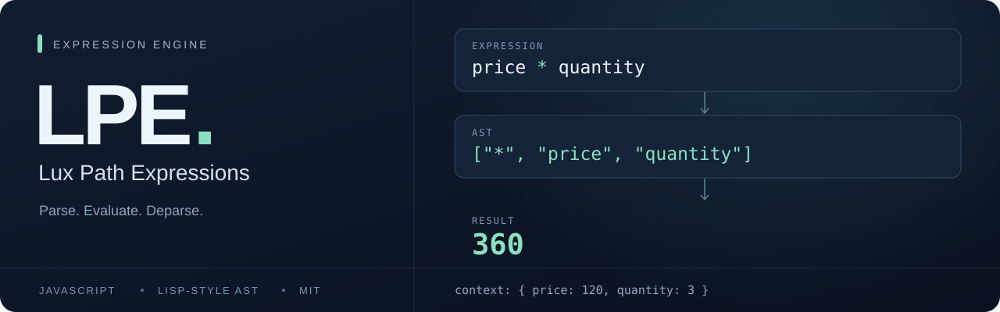

<p align="center">
  
</p>

# Lux Path Expressions

**Движок разбора и вычисления выражений на JavaScript.**

LPE преобразует формулы в абстрактные синтаксические деревья (AST) в стиле Lisp, вычисляет их с вашими данными и функциями и переводит AST обратно в текст выражения.

[](https://github.com/luxms/luxmsbi-lpe/blob/master/src/index.js)
[](https://github.com/luxms/luxmsbi-lpe/blob/master/src/index.d.ts)
[](https://github.com/luxms/luxmsbi-lpe/blob/master/LICENSE)

[English](README.md) · **Русский**

[Быстрый старт](#быстрый-старт) · [Примеры](#примеры) · [Синтаксис](#синтаксис) · [API](#api) · [Разработка](#разработка) · [Документация](#документация)

## Возможности

- **Разбор формул.** AST хранится во вложенных массивах, которые описывают вызовы функций, операторы и литералы.
- **Вычисление с контекстом.** Передавайте данные приложения и JavaScript-функции вместе со стандартной библиотекой.
- **Составные выражения.** Используйте цепочки вызовов, массивы, объекты и локальные переменные `VAR … RETURN`.
- **Асинхронные значения.** При вычислении движок дожидается аргументов Promise; реактивные потоки можно подключить через `streamAdapter`.
- **Генерация текста выражения.** Функция `deparse` преобразует AST обратно в LPE.

## Быстрый старт

Для сборки из исходников нужны Node.js и npm. Примеры описывают текущую ветку `master`.

```sh
git clone https://github.com/luxms/luxmsbi-lpe.git
cd luxmsbi-lpe
npm ci
npm run build
```

После сборки появится `dist/lpe.js`. Выполните команду из корня репозитория:

```sh
node -e "console.log(require('./dist/lpe').eval_lpe('2 + 3 * 4'))"
```

Результат: `14`.

Пакет называется `@luxms/lpe`. В примерах ниже используется локальная сборка. Она поддерживает CommonJS, AMD и глобальный объект `lpe` в браузере. В репозитории также есть [объявления типов для TypeScript](https://github.com/luxms/luxmsbi-lpe/blob/master/src/index.d.ts).

## Примеры

### Разбор, вычисление и обратное преобразование

```js
const { parse, eval_lpe, eval_lisp, deparse } = require('./dist/lpe');

const context = { price: 120, quantity: 3 };

eval_lpe('price * quantity', context); // 360

const ast = parse('price * quantity');
// ['*', 'price', 'quantity']

eval_lisp(ast, context); // 360
deparse(ast);           // 'price * quantity'
```

`parse` строит AST без выполнения выражения. Готовое дерево можно вычислить через `eval_lisp`, а `eval_lpe` объединяет разбор и вычисление в одном вызове. Функция `deparse` создаёт текст выражения, но не сохраняет исходное форматирование и комментарии.

### Свои функции

```js
const { eval_lpe } = require('./dist/lpe');

eval_lpe('amount.double()', {
  amount: 21,
  double: value => value * 2,
}); // 42
```

Точка передаёт значение слева первым аргументом: `amount.double()` вызывает `double(amount)`. Для вызова JavaScript-метода объекта используйте `~>`.

### Расчёт с локальными переменными

```js
const { eval_lpe } = require('./dist/lpe');

eval_lpe(`
  VAR subtotal = price * quantity
  VAR discount = subtotal * 0.1
  RETURN subtotal - discount
`, { price: 120, quantity: 3 }); // 324
```

Переменные вычисляются по порядку: каждая может использовать объявленные перед ней. Ключевые слова `VAR` и `RETURN` пишутся в верхнем регистре.

### Работа с Promise

```js
const { eval_lpe } = require('./dist/lpe');

const result = eval_lpe('price * quantity', {
  price: Promise.resolve(120),
  quantity: 3,
});

result.then(value => console.log(value)); // 360
```

## Синтаксис

| Возможность | Выражение | Результат |
| --- | --- | --- |
| Арифметика | `2 + 3 * 4` | `14` |
| Логика | `(3 > 2) and not false` | `true` |
| Массив | `[1, 2, 3]` | `[1, 2, 3]` |
| Объект | `{name = "Ada", score = 42}` | `{name: "Ada", score: 42}` |
| Доступ к свойству | `{score = 42}.score` | `42` |
| Пустой объект | `{=}` | `{}` |
| Пустой массив | `{}` | `[]` |
| JavaScript-метод | `"hello" ~> toUpperCase()` | `"HELLO"` |
| Последовательность выражений | `x := 2; x + 3` | `5` |

Выражения верхнего уровня разделяются точкой с запятой или переносом строки. Между аргументами функций допустимы `,` и `;`. Для комментариев используются `//`, `--` и `/* … */`.

При сочетании `and` и `or` явно задавайте группировку скобками: в парсере эти операторы имеют одинаковый приоритет.

<details>
<summary>Как выражения записываются в AST</summary>

Первый элемент массива AST задаёт операцию или функцию. Числа остаются числами, имена записываются строками. У строковых литералов есть отдельный узел кавычек.

| Исходный текст | AST |
| --- | --- |
| `2 + 3 * 4` | `["+", 2, ["*", 3, 4]]` |
| `double(21)` | `["double", 21]` |
| `"hello"` | `["\"", "hello"]` |
| `[1, 2, 3]` | `["[", 1, 2, 3]` |
| `a.b()` | `[".", "a", ["b"]]` |
| `a(); b()` | `["begin", ["a"], ["b"]]` |

</details>

## API

| Функция | Назначение |
| --- | --- |
| `parse(source, options?)` | Разбирает текст LPE в AST. |
| `eval_lpe(source, context?, options?)` | Разбирает и вычисляет выражение. |
| `eval_lisp(ast, context?, options?)` | Вычисляет AST с контекстом и стандартной библиотекой. |
| `deparse(ast, options?)` | Преобразует AST в текст LPE. |

Модуль также экспортирует `LPESyntaxError`, `STDLIB` и функции для работы со специальными формами, переменными, документацией и локализацией. См. [список экспортов](https://github.com/luxms/luxmsbi-lpe/blob/master/src/index.js) и [типы параметров](https://github.com/luxms/luxmsbi-lpe/blob/master/src/index.d.ts).

## Разработка

Перед тестами соберите проект: тесты импортируют `dist/lpe.js`.

```sh
npm ci
npm run build
npm test
```

| Команда | Назначение |
| --- | --- |
| `npm run watch` | Пересобирает проект при изменении исходников. |
| `npm run t` | Запускает тесты парсера из `test/test.js`. |
| `npm run test-lisp` | Запускает тесты вычислителя из `test/test-lisp.js`. |

Чтобы посмотреть AST из командной строки на системе с `/dev/stdin`:

```sh
echo "2 + 3 * 4" | npm run cli
```

Для вычисления выражения замените `npm run cli` на `npm run eval`. Оба скрипта читают `/dev/stdin`; на Windows используйте команду `node -e` из раздела [«Быстрый старт»](#быстрый-старт).

## Документация

- [Заметки о языке и движке](https://github.com/luxms/luxmsbi-lpe/blob/master/docs/README.md) — синтаксис, правила вычисления и детали реализации.
- [Справочник стандартной библиотеки](https://github.com/luxms/luxmsbi-lpe/blob/master/src/context/README.md) — встроенные функции с примерами на русском языке.
- [История изменений](https://github.com/luxms/luxmsbi-lpe/blob/master/CHANGELOG.md) — записи о выпусках.
- [Примеры для браузера и AMD](https://github.com/luxms/luxmsbi-lpe/tree/master/demo) — варианты подключения библиотеки.

Если нашли ошибку, приложите выражение, контекст и ожидаемый результат к [задаче на GitHub](https://github.com/luxms/luxmsbi-lpe/issues). При изменении кода добавьте тест, воспроизводящий проблему, и выполните сборку и тесты перед созданием pull request.

## Лицензия

[MIT](https://github.com/luxms/luxmsbi-lpe/blob/master/LICENSE) · Copyright (c) 2019 Luxms Inc.
